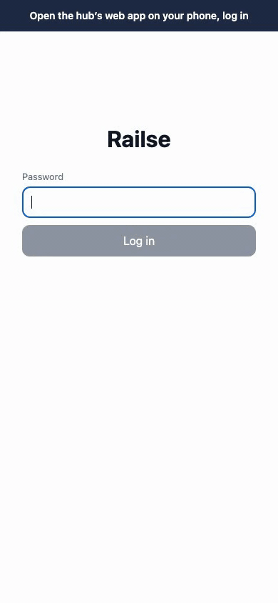

<p align="center"></p>

# Railse OPC

[中文](README.md)

A self-hosted approval inbox for people running Claude Code, Codex CLI and Gemini CLI at once. Rules auto-allow the boring stuff; everything else goes to your phone.

- **Rules first.** Seven risk levels. Reads and in-project edits are allowed automatically, network asks, and pushes or destructive commands can never be auto-allowed, whatever you "remember".
- **Three CLIs, one inbox.** Approvals, Claude Code's multiple-choice questions, "waiting for you" and "finished" from every agent on every machine, in one place.
- **One machine is enough.** `railse setup all --local-hub` runs the hub on your laptop and exposes it with Tailscale Funnel. No cloud account, no relay through anyone else's servers.

```sh
curl -fsSL https://raw.githubusercontent.com/xufei547/railse-opc/main/install.sh | sh
railse setup all --local-hub
```

The CLIs stop and ask "allow this?" every time they want to run a command or edit a file. Railse takes over that step: what the rules can decide is approved or denied on the spot, what they can't goes to your phone, you tap once, and the agent carries on. The same goes for Claude Code's multiple-choice questions ("use approach A or B?"): you pick an option or type a line on the phone, and it continues right away.

OPC stands for "one-person company".

## The problem

While an agent writes code, the only thing it actually needs from you is a tap on "allow" before every real action: running a command, editing a file, hitting the network, pushing code. With one agent that's fine. With three terminals open it turns into this:

- **You can't tell which one is waiting.** You cycle through the windows, and by the time you get to it, it has been waiting ten minutes.
- **Leaving the desk stops everything.** Go out for lunch and come back to every agent stuck on its first `git push`.
- **Allowing everything is too risky.** `--dangerously-skip-permissions` and `--yolo` stop the questions, but one `git push --force` or `rm -rf` and there's no undo.
- **Each CLI has its own allowlist.** Three CLIs, three permission formats that don't share anything. What's on the list gets through; what isn't still needs a `y` in the terminal, and waits if you're not there.

Railse turns all of that into one rule: **every approval goes through the rules first, only what the rules can't decide goes to a person, and the person is reached on their phone.**

## How it does it

1. **All three CLIs' permission hooks talk to one daemon.** Every machine you write code on runs `railse agent`. Every Bash, file-write and network call from Claude Code passes through it before it runs (`PreToolUse`), whatever the permission mode, auto mode included; Codex and Gemini CLI go through their own permission events (Gemini CLI hooks can deny but not approve, see the limitations below). Adding a fourth CLI is one more translator; the rules don't change.
2. **Each request is risk-rated first, then matched against rules.** Commands are classified into seven levels by a built-in table. The built-in rules allow only two of them: read-only, and edits inside the project. Network, edits outside the project, pushes and deletes all ask.

   | Level | Examples | Default |
   |---|---|---|
   | Read-only | `ls`, `cat`, `grep`, `git status`, `git diff`, `go test`, `npm test` | allow |
   | Write inside the project | editing files under the project root | allow |
   | Unknown | commands not in the table; paths with variables or globs | ask |
   | Write outside the project | editing files outside the project root | ask |
   | Network | `curl`, `npm install`, `pip install`, `brew install` | ask |
   | Outward | `git push`, `gh pr create`, `npm publish`, any `deploy`, mail and payment CLIs | ask; can't be remembered as allowed |
   | Destructive | `rm -rf`, `git reset --hard`, `git push --force`, `DROP TABLE`, `docker system prune`; reading or writing `.env`, `*.pem`, `~/.ssh`, autostart configs | ask; can't be remembered as allowed |

   Compound commands are split on `&&`, `;` and `|`, each part is rated, and the highest level wins. An allow rule has to match every part; a deny rule fires if any part matches.
3. **What the rules can't decide goes to your phone.** The daemon sends the request to a hub you host yourself, the hub pushes a notification to your phone, and the page opens with one plain sentence on who wants to do what, where, and why you are being asked, then the command verbatim, with one button to approve and one to deny.
4. **Approve once, not every time.** Turn on Remember when you approve or deny, and a rule is created on the spot, scoped to this project by default or to all projects if you choose; you see the draft before it's saved. Rules live on the hub, so they follow you to other machines.
5. **The floor is hard-coded in the engine.** Outward and destructive actions can never be remembered as allowed. The only way to allow them is a hand-written rule that names the risk level explicitly. The engine checks this when rules are created and when they're imported, and the web app can't override it.
6. **Undecided calls go to a human.** If the hub cannot be reached for 30 seconds, the CLI handles confirmation; Gemini calls that cross a role boundary or touch Railse configuration are denied outright. See "Status and limitations" for cases where Railse was enabled but its daemon is unreachable, a request exceeds limits, or no policy verdict is available.
7. **Claude Code's multiple-choice questions can be answered on your phone.** When it asks with `AskUserQuestion`, the question skips the rules and goes straight to your phone. You pick an option or type your own line and the agent continues at once, with no prompt in the terminal; or tap "Ask me in the terminal instead" to hand it back. With no hub, an unreachable hub or a timeout, the terminal asks as usual.

What each CLI supports:

| | Can approve | Deny only | Reminders only | Answer questions on the phone | Works in auto / yolo mode | Time-limited trust |
|---|---|---|---|---|---|---|
| Claude Code | yes | — | waiting for you, finished | yes (`AskUserQuestion`) | yes: outward and destructive go to your phone in any mode; the terminal shows the same prompt, first answer wins; network, writes outside the project and unknown commands go to Claude first and reach the phone only when Claude asks | session or project; from the phone, the terminal or `RAILSE_TRUST` |
| Codex | yes (interactive sessions) | — | finished | no | depends on Codex's own `approval_policy` | project (phone, terminal); session from the phone only |
| Gemini CLI | no | yes | questions, finished | no | no (yolo skips hooks) | not applicable (hooks can't approve) |

Besides approvals and these questions, the inbox also shows when an agent stops to wait for your next message and when it finishes, telling you which machine and directory to go to in the terminal. Human-approval steps from workflows like n8n can be posted to the hub's webhook and show up in the same inbox as agent approvals. See [docs/integrations/n8n.en.md](docs/integrations/n8n.en.md).

<p align="center"></p>

In the demo, Claude Code wants to run `curl`; no rule decides it, so it goes to the phone. Approving with Remember on adds a learned rule, then a multiple-choice question from Claude Code is answered on the phone.

## Time-limited trust

When you're watching one window and don't want to approve every step, you can hand over a session or a project for a while (new in 0.2.3). Three ways in:

- **Phone.** When you approve a request, turn on "Trust this for a while", pick this session or this project, and 30 minutes, 2 hours or 24 hours.
- **Terminal.** `railse trust 2h` inside a project directory (2 hours by default) trusts that project: requests from every CLI on this machine working in it. `railse trust list` shows what's active; `railse trust revoke <id>` or `--all` ends it. `--session <session id>` trusts one Claude Code session instead.
- **Launch command.** `RAILSE_TRUST=2h claude` trusts just that window, counted from the first action the rules can't decide.

**While a trust is active, undecided requests in its scope are automatically allowed. It expires on its own, after at most 24 hours.** Durations are clamped to 5 minutes – 24 hours, with at most 20 active per machine. Exceptions: role boundaries and Railse configuration protection still apply, deny rules still deny, other requests still go back to the terminal during a global pause, and multiple-choice questions still go to your phone. The phone inbox shows a banner while trusts are active, and the "Time-limited trusts" section in Settings lists them with a Revoke button. Creating, revoking and expiring are all audited. Details: "限时放行" in [docs/agent-local-loop.md](docs/agent-local-loop.md).

## Roles

A role gives an agent session a permission boundary, defined in `~/.railse/roles.yaml` on the machine:

```yaml
version: 1
roles:
  - {name: dev, ceiling: network}
  - name: writer
    ceiling: write_in_project
    forbid: [{command_prefix: "git push"}]
  - {name: ops, ceiling: destructive}
```

Bind with `RAILSE_ROLE=writer claude`, or set `dirs` on a role to bind by project directory. Nested sessions with hooks inherit the parent's constraints (see the Codex limitation below). Above `ceiling`, a human must decide: no remembered allowance or time-limited trust. A `forbid` match is denied outright. The phone's Desk groups waiting requests, active trusts, denials and auto-approvals in the last 24 hours, and recent actions by machine and role.

`railse role init` writes a starter template without overwriting. `railse role list` lists boundaries and directories. `railse role check` validates and flags overlapping or missing directories. `railse role which` explains what the current directory and `RAILSE_ROLE` resolve to.

**It is not a sandbox.** Roles constrain properly hooked tool calls Railse can recognize, catching mistakes and obvious overreach. They cannot guarantee blocking an injected agent deliberately evading them. Use an OS sandbox or container for hard isolation. See the full [list of limitations](docs/agent-local-loop.md#角色防什么不防什么) (Chinese).

## Why not Claude Code's Remote Control?

Remote Control is great if Claude Code is the only agent you run and you don't mind the relay. Railse is for the rest of us.

| | Claude Code Remote Control | Railse |
|---|---|---|
| CLIs covered | Claude Code | Claude Code, Codex CLI, Gemini CLI |
| Where it runs | Relays through Anthropic's servers; the transcript is stored there; execution stays on your machine | Your own hub: a laptop with Tailscale Funnel, a VPS, or Fly |
| Rules | Claude Code's own allow/deny lists; nothing risk-based, nothing you can teach from the phone | Seven risk levels, auto-allow for low risk, "remember" from the phone, and a hard floor: destructive and outward actions are never auto-allowed |
| Questions on the phone | Yes | Yes for Claude Code's `AskUserQuestion`; Codex and Gemini questions are shown, not answered |
| Account needed | Pro, Max, Ultra, Team or Enterprise plan; API keys not supported | None beyond your own hub password |

Codex has its own phone approvals through the ChatGPT desktop and mobile apps; the standalone Codex CLI has none, and nothing official that I know of covers Gemini CLI. Railse hooks into all three at the CLI level, with one set of rules.

## How it works

```
Claude Code / Codex CLI / Gemini CLI
   │ permission hook
   ▼
railse agent (policy engine) ──rule matched──▶ allow / deny
   │ undecided
   ▼
railse hub ──Web Push──▶ phone ──allow / deny──▶ hub ▶ daemon ▶ hook
```

Each machine you write code on runs a daemon, `railse agent`. It gets requests from the CLIs' permission hooks over a local Unix socket and sends the ones the rules can't decide to the hub over a WebSocket it opens itself. For an approval the hub can only answer allow or deny; for a Claude Code multiple-choice question it can only give an answer (text filled into the question, not a command) or hand it back to the terminal. It also serves the phone web app (a PWA), so there's nothing else to deploy.

## Install

```sh
curl -fsSL https://raw.githubusercontent.com/xufei547/railse-opc/main/install.sh | sh
```

Supported: macOS on Apple Silicon, Linux on amd64 and arm64. The script downloads the release from GitHub, checks its sha256, and installs to `/usr/local/bin` if that's writable, otherwise to `~/.local/bin`. It never calls sudo. Run it again to upgrade.

`go install github.com/xufei547/railse-opc/cmd/railse@latest` also works, but that binary doesn't include the web app, so it's only good for work machines.

## Getting started

**One machine is enough.** Install [Tailscale](https://tailscale.com/download) on your work machine and log in, then:

```sh
railse setup all --local-hub
```

It starts a hub on this machine, uses Tailscale Funnel to give your phone a fixed https address (no server, domain or certificate), enrolls the local daemon, installs the hooks, sets up autostart, runs the health check, and prints the address to open on your phone. The first run asks you to set the password you'll log in with on the phone. If your tailnet hasn't enabled Funnel yet, it prints the link to enable it; run the command again afterwards. When the machine sleeps the hub is down too, but the agents are stopped then as well, so a single-machine user loses nothing. With several machines, put the hub on the one that stays on. If your phone goes through a proxy and can't open the address, turn the proxy off or make `ts.net` go direct in its rules. Details: the "一台机器就够：本机 hub" section of [docs/setup.md](docs/setup.md).

**Have a server?** Three steps: the hub machine, each work machine, the phone.

1. **Hub machine.** Point a domain at it and open ports 443 and 80 to the internet. On macOS:
   ```sh
   railse hub password    # reads the web login password from stdin, at least 8 characters
   railse hub run --acme-domain hub.example.com
   ```
   The hub runs in the foreground and gets its own Let's Encrypt certificate. On Linux a normal user can't bind 443/80, so run it as a systemd service or behind a reverse proxy; see [docs/setup.md](docs/setup.md). No server? `deploy/fly/` has a ready-made Fly.io setup, see below.
2. **Each work machine.** On the hub machine, run `railse hub token` to get an enrollment code (valid for 10 minutes, one per machine). Then on the work machine:
   ```sh
   railse setup
   ```
   It asks for the hub URL, the code and a machine name (defaults to the hostname). To pass everything up front: `railse setup all --hub https://hub.example.com --token <code>`. It enrolls the machine, installs user-level hooks for all three CLIs and wires up Codex's `notify`, sets up autostart, runs `railse doctor`, and prints the URL to open on your phone.
3. **Phone.** Open that URL and log in with the password from step 1. On iPhone, open it in Safari, tap Share, then Add to Home Screen, open it from the Home Screen icon, and tap 开启通知 (enable notifications) under 设置 (settings).

After that, just use the three CLIs as usual. `railse doctor --project <dir>` tells you which project root a directory gets. To deny every `rm`, add one rule to `~/.railse/rules.yaml`; see [docs/agent-local-loop.md](docs/agent-local-loop.md).

## Where the data goes

- **The daemon only connects outward, to the hub.** For an approval the hub can only answer allow or deny, and for a Claude Code question only give an answer (text filled into the question, not a command) or hand it back to the terminal; there is still no channel for sending commands to your machines. A typed-in answer is free text, though, and Claude acts on it as your reply, so anyone who can log in to the hub's web app can steer the agent through it. That's the same trust boundary as the hub password already granting every approval.
- **Payloads are redacted on your machine first.** Tokens and passwords in commands that the redaction rules recognize become `<redacted>` before they leave your machine. A secret they don't recognize reaches the hub and the phone unchanged; see [SECURITY.md](SECURITY.md).
- **The hub stores hashes.** Machine secrets and login sessions are stored only as hashes. The few things that have to be stored in plaintext, such as the push signing key and webhook callback tokens, are listed in SECURITY.md.
- **You host the hub.** The phone web app is served by the hub behind one password, and the data stays on your own server.

## Running the hub on Fly.io

`deploy/fly/` has a Dockerfile and a `fly.toml`. Fly terminates TLS and the hub's data lives on a 1 GB volume. Before deploying, edit three things in `fly.toml`: set `app` to your app name, set `RAILSE_PUBLIC_URL` to `https://<app>.fly.dev` and don't change it later, and set `primary_region` to the region you create the volume in. Leave `auto_stop_machines` set to `"off"`, because daemons and phones keep long-lived connections to the hub. The commands (create the app and volume, set the initial password secret, deploy, get an enrollment code) are in the "部署到 Fly.io" section of [docs/hub.md](docs/hub.md).

## Docs

Most docs under `docs/` are in Chinese; the integration guides below have English translations.

- [docs/setup.md](docs/setup.md): install, the local hub (one machine is enough), hub deployment (Linux service, reverse proxy), enrolling machines, autostart, `railse doctor` checks, upgrades
- [docs/hub.md](docs/hub.md): hub API, Desk, push notifications, security, Fly.io, troubleshooting
- [docs/web.md](docs/web.md): the phone web app
- [docs/agent-local-loop.md](docs/agent-local-loop.md): daemon, hooks, rules, roles, time-limited trusts, audit log
- [Using Railse with Paperclip](docs/integrations/paperclip.en.md)
- [Using Railse with herdr](docs/integrations/herdr.en.md)
- [Design doc](docs/superpowers/specs/2026-10-21-railse-opc-design.md)
- [CONTRIBUTING.md](CONTRIBUTING.md) and [SECURITY.md](SECURITY.md)

## Status and limitations

- This is v0.3.0, and the author is dogfooding it.
- **Upgrading from 0.2.3:** the hub database moves to v7 (role columns on sessions and requests, a beyond-role flag on requests, and a new `machine_roles` table) the first time it opens and cannot be downgraded. Back up the hub data directory first. Upgrade and restart both the daemon and the hub to get Desk on the phone. **Rerun `railse setup hooks` once** (no CLI flag reinstalls all three; or use `--claude`, `--codex`, `--gemini` separately). Hook commands now pin the daemon socket's absolute path, and Claude's `PreToolUse` matcher adds MCP tools and WebSearch. Without reinstalling, roles cannot constrain these calls when Claude needs no native confirmation. `railse doctor` reports under `hooks.claude`: "the PreToolUse matcher is outdated (no MCP tools or WebSearch), so role limits and forbidden lists don't reach them". Under `hooks.claude`, `hooks.codex`, and `hooks.gemini`, old commands get: "the hook command has no --socket, so a session started with a different HOME can't reach the daemon". See [upgrading](docs/setup.md#升级) (Chinese).
- **Intentional tightening since 0.2.3, with or without roles:** time-limited trusts no longer cover Railse's own configuration directories (`~/.railse`, any `.railse` directory, and the actual daemon directory). Calls recognized as reading or writing them accept no automatic allowance. If the daemon directory contains `roles.yaml`, `machine.json`, or a leftover `agent.sock` but the daemon cannot be reached, or a request exceeds limits or gets an unreadable reply so no policy verdict is available, Claude's `PreToolUse` asks in the terminal and Gemini denies, instead of silently handing back. MCP/WebSearch `PreToolUse` still hands back when there is no `roles.yaml`. Restore the daemon with `railse agent run` or `railse setup autostart`; to disable Railse completely, [uninstall the hooks](docs/setup.md#安装), since stopping the service alone is not enough. Commands over 128 KiB are no longer parsed: they are `unknown`, and beyond-role when a role applies. Wrapped commands (`command`, `env`, `sudo`, `xargs`, etc.) take the higher risk of the wrapper and inner command.
- Roles cannot constrain Codex's confirmation-free modes or `codex exec`: only `PermissionRequest` is hooked. For calls that reach its hooks, Gemini always denies beyond-role requests and access to Railse configuration, because it has no reliable channel for asking a human.
- When a call is within its role boundary, does not touch Railse configuration, and has no matching trust, Claude Code network calls, writes outside the project and commands Railse hasn't seen are left to Claude first, in every permission mode: whatever your Claude allow list or auto mode's classifier lets through just runs, and only when Claude decides to ask does it reach the phone. Outward and destructive actions always reach the phone, and the terminal shows Claude's own prompt at the same time (the reason starts with "Railse:" and names the part of the command that triggered it); answer on either side. If the hub can't be reached, only the terminal prompt is left. To send all of them to the phone, put `claude_undecided: phone` in `~/.railse/settings.yaml` and run `railse agent reload`.
- When Railse allows a call at `PreToolUse` (the built-in read-only and in-project rules, or an allow rule you remembered), Claude Code skips its own permission checks; deny rules in Claude's `settings.json` still apply first.
- Upgrading from 0.2.0: rerun `railse setup hooks --claude` once so Claude's `PreToolUse` hook also matches Bash and the other tools (`railse doctor` reports it under `hooks.claude`); until then approvals in auto mode still bypass Railse.
- Upgrading from 0.2.1: the hub database moves to v5 (requests get a trigger column), so upgrade both the daemon and the hub. Afterwards actions like `git push` and `rm -rf` pop up Claude's own prompt in the terminal with a reason starting "Railse:", and the same request is on your phone; answer on either side. Rerun `railse setup hooks --claude` once to add the `PostToolUse` hook (`railse doctor` flags it under `hooks.claude`): in the Claude Code desktop app it clears phone cards for requests already handled on this machine; without it they stay until they expire.
- Upgrading from 0.2.2: the hub database moves to v6 (a new `trusts` table for time-limited trusts) the first time it's opened and can't be downgraded, so back up the hub data directory first. Upgrade and restart both the daemon and the hub to get the trust switch on the phone; with only the daemon upgraded, `railse trust` and `RAILSE_TRUST` still work on that machine but the phone doesn't see them. Hooks needed no reinstall for 0.2.3; upgrading to 0.3.0 still requires the reinstall above.
- `RAILSE_TRUST` only works with Claude Code and creates one trust per session: once it expires or is revoked it isn't created again. To keep going, open a new window or use `railse trust`.
- Most docs under `docs/` are in Chinese for now; the CLI and the phone web app are in both languages.
- Gemini CLI hooks can deny but can't approve: rule denials, beyond-role calls, access to Railse configuration, and missing policy verdicts are denied; other calls go back to Gemini's own prompt and never reach the phone. Needs Gemini CLI 0.65.0 or later.
- On the phone you can only answer Claude Code's multiple-choice questions (`AskUserQuestion`). Questions from Codex and Gemini, and an agent stopping to wait for your next message, are still reminders only: you go back to the terminal.
- The project started in Chinese; the English UI is new in 0.2. If something reads oddly, open an issue with the sentence.
- Upgrading from before 0.2: the CLI, the phone web app and the push copy now follow your system language (`RAILSE_LANG` → the `lang` file in the data directory → `LANG`; anything but zh* is English). To force one: `railse lang zh|en`; the phone has its own switch in Settings. The hub's database moves from v3 to v4 the first time 0.2 opens it (push subscriptions get a language column) and can't be downgraded, so back up the hub data directory first.
- Upgrading from before 0.1.5: on machines that already have the hooks installed, rerun `railse setup hooks --claude` once to add the `PreToolUse` hook the questions need (`railse doctor` reports it under `hooks.claude`). Upgrade the hub before, or together with, the daemon; while the hub is still the old version, questions go straight back to the terminal. A local hub and the daemon are separately managed processes, and rerunning `railse setup` doesn't restart a local hub that's already running, so restart it yourself after upgrading (macOS: `launchctl kickstart -k gui/$(id -u)/dev.railse.hub`; Linux: `systemctl --user restart railse-hub`). See "升级" (upgrading) in [docs/setup.md](docs/setup.md).
- Codex hooks only fire in interactive sessions (`codex exec` doesn't trigger them). Before the first use, review them with `/hooks` inside Codex.
- The hub is one process with one SQLite database and can't run as multiple instances.
- A project inside a system directory such as `/opt`, `/usr` or `/var` has no project root, even if it's a git repo (`/opt/homebrew` is one), so every write needs approval. Projects under your home directory, `/tmp` or macOS's per-user `$TMPDIR` aren't affected.
- On iPhone (iOS 16.4 or later), push notifications only work after you add the page to the Home Screen and open it from there.
- Push on a real iPhone hasn't been fully tested yet: after the app is swiped away, with the screen locked, or hours later.
- Pick the hub's domain on day one. Push subscriptions and the Home Screen app are tied to it, so changing it means deleting the icon, adding it again and re-enabling notifications on every phone.
- A local hub's address is tied to the Tailscale machine name, so renaming the machine changes the domain: every phone has to add the app to the Home Screen again and re-enable notifications.

## Development

```sh
make test    # gofmt, golangci-lint, go vet, go test -race, web checks
make e2e     # end-to-end with a real hub, daemon and hooks (Playwright)
make demo    # re-records assets/demo.gif (Chinese); DEMO_LANG=en make demo records assets/demo.en.gif (needs ffmpeg)
```

[CONTRIBUTING.md](CONTRIBUTING.md) covers the required tools and how to send changes.

## Buy me a coffee

I open-sourced this because I use it every day. If it helps you too, you can buy me a coffee on Ko-fi.

<a href="https://ko-fi.com/railsexu"></a>

## License

[Apache License 2.0](LICENSE), copyright xufei547. The "Railse" name and the switch-track logo are not covered by the license; keep [NOTICE](NOTICE) when you redistribute.
