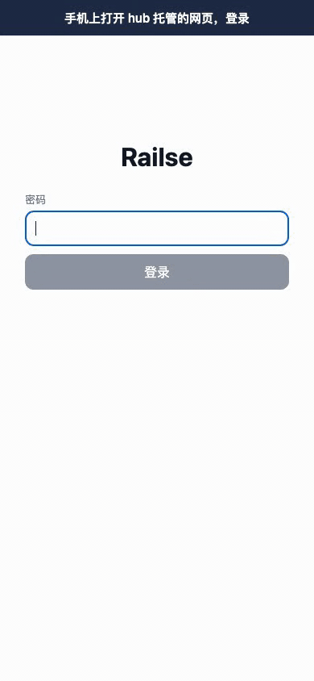

<p align="center"></p>

# Railse OPC

[中文](README.md)

Railse OPC uses a rule-based policy engine to approve or deny tool calls from Claude Code, Codex CLI and Gemini CLI, and sends the ones the rules can't decide to an inbox on your phone (for Gemini CLI they go back to the terminal). It's for one person running several AI coding agents at the same time.

OPC stands for "one-person company".

- **Rules decide first.** The built-in rules allow read-only commands and edits inside the project; anything else, like `git push` or `curl`, goes to your phone.
- **Failures go back to the terminal.** If the daemon isn't running, or the hub can't be reached for 30 seconds, the CLI shows its own permission prompt. Worst case, it's as if Railse weren't installed.
- **Decisions can become rules.** Turn on 记住 (remember) when you approve or deny, and the decision is saved as a rule for that project or for all projects. Pushes, publishing and destructive commands (recursive deletes, force pushes) can't be remembered as allowed.
- **You run the hub, and payloads are redacted first.** Tokens and passwords in commands that the redaction rules recognize become `<redacted>` before they leave your machine (a secret they don't recognize reaches the hub and the phone unchanged; see [SECURITY.md](SECURITY.md)), and the hub stores machine secrets and login sessions as hashes.

<p align="center"></p>

The demo shows the phone web app, whose UI is in Chinese. Claude Code wants to run `curl`, no rule decides it, so it goes to the phone. Approving it with 记住 (remember) turned on adds a learned rule.

## How it works

```
Claude Code / Codex CLI / Gemini CLI
   │ permission hook
   ▼
railse agent (policy engine) ──rule matched──▶ allow / deny
   │ undecided
   ▼
railse hub ──Web Push──▶ phone ──allow / deny──▶ hub ▶ daemon ▶ hook
```

Each machine you write code on runs a daemon, `railse agent`. It gets requests from the CLIs' permission hooks over a local Unix socket and sends the ones the rules can't decide to the hub over a WebSocket it opens itself. For each request the hub can only answer allow or deny. It also serves the phone web app (a PWA), so there's nothing else to deploy.

## Install

```sh
curl -fsSL https://raw.githubusercontent.com/xufei547/railse-opc/main/install.sh | sh
```

Supported: macOS on Apple Silicon, Linux on amd64 and arm64. The script downloads the release from GitHub, checks its sha256, and installs to `/usr/local/bin` if that's writable, otherwise to `~/.local/bin`. It never calls sudo. Run it again to upgrade.

`go install github.com/xufei547/railse-opc/cmd/railse@latest` also works, but that binary doesn't include the web app, so it's only good for work machines.

## Getting started

1. **Hub machine.** Point a domain at it and open ports 443 and 80 to the internet. On macOS:
   ```sh
   railse hub password    # reads the web login password from stdin, at least 8 characters
   railse hub run --acme-domain hub.example.com
   ```
   The hub runs in the foreground and gets its own Let's Encrypt certificate. On Linux a normal user can't bind 443/80, so run it as a systemd service or behind a reverse proxy; see [docs/setup.md](docs/setup.md).
2. **Each work machine.** On the hub machine, run `railse hub token` to get an enrollment code (valid for 10 minutes, one per machine). Then on the work machine:
   ```sh
   railse setup
   ```
   It asks for the hub URL, the code and a machine name (defaults to the hostname). To pass everything up front: `railse setup all --hub https://hub.example.com --token <code>`. It enrolls the machine, installs user-level hooks for all three CLIs and wires up Codex's `notify`, sets up autostart, runs `railse doctor`, and prints the URL to open on your phone.
3. **Phone.** Open that URL and log in with the password from step 1. On iPhone, open it in Safari, tap Share, then Add to Home Screen, open it from the Home Screen icon, and tap 开启通知 (enable notifications) under 设置 (settings).

## Running the hub on Fly.io

`deploy/fly/` has a Dockerfile and a `fly.toml`. Fly terminates TLS and the hub's data lives on a 1 GB volume. Before deploying, edit three things in `fly.toml`: set `app` to your app name, set `RAILSE_PUBLIC_URL` to `https://<app>.fly.dev` and don't change it later, and set `primary_region` to the region you create the volume in. Leave `auto_stop_machines` set to `"off"`, because daemons and phones keep long-lived connections to the hub. The commands (create the app and volume, set the initial password secret, deploy, get an enrollment code) are in the "部署到 Fly.io" section of [docs/hub.md](docs/hub.md).

## Docs

The docs under `docs/` are in Chinese.

- [docs/setup.md](docs/setup.md): install, hub deployment (Linux service, reverse proxy), enrolling machines, autostart, `railse doctor` checks, upgrades
- [docs/hub.md](docs/hub.md): hub API, push notifications, security, Fly.io, troubleshooting
- [docs/web.md](docs/web.md): the phone web app
- [docs/agent-local-loop.md](docs/agent-local-loop.md): daemon, hooks, rules, audit log
- [Design doc](docs/superpowers/specs/2026-10-21-railse-opc-design.md)
- [CONTRIBUTING.md](CONTRIBUTING.md) and [SECURITY.md](SECURITY.md)

## Status and limitations

- This is v0.1.1, the first version, and the author is dogfooding it.
- The phone web app, the CLI output and the docs under `docs/` are in Chinese only for now.
- Gemini CLI hooks can deny but can't approve: rule denials still apply, and everything else goes back to Gemini's own prompt and never reaches the phone. Needs Gemini CLI 0.65.0 or later.
- Codex hooks only fire in interactive sessions (`codex exec` doesn't trigger them). Before the first use, review them with `/hooks` inside Codex.
- The hub is one process with one SQLite database and can't run as multiple instances.
- A project inside a system directory such as `/opt`, `/usr` or `/var` has no project root, even if it's a git repo (`/opt/homebrew` is one), so every write needs approval. Projects under your home directory, `/tmp` or macOS's per-user `$TMPDIR` aren't affected.
- On iPhone (iOS 16.4 or later), push notifications only work after you add the page to the Home Screen and open it from there.
- Push on a real iPhone hasn't been fully tested yet: after the app is swiped away, with the screen locked, or hours later.
- Pick the hub's domain on day one. Push subscriptions and the Home Screen app are tied to it, so changing it means deleting the icon, adding it again and re-enabling notifications on every phone.

## Development

```sh
make test    # gofmt, golangci-lint, go vet, go test -race, web checks
make e2e     # end-to-end with a real hub, daemon and hooks (Playwright)
make demo    # re-records assets/demo.gif the same way (needs ffmpeg)
```

[CONTRIBUTING.md](CONTRIBUTING.md) covers the required tools and how to send changes.

## Buy me a coffee

I open-sourced this because I use it every day. If it helps you too, you can buy me a coffee on Ko-fi.

<a href="https://ko-fi.com/railsexu"></a>

## License

[Apache License 2.0](LICENSE)
